# Campfire  

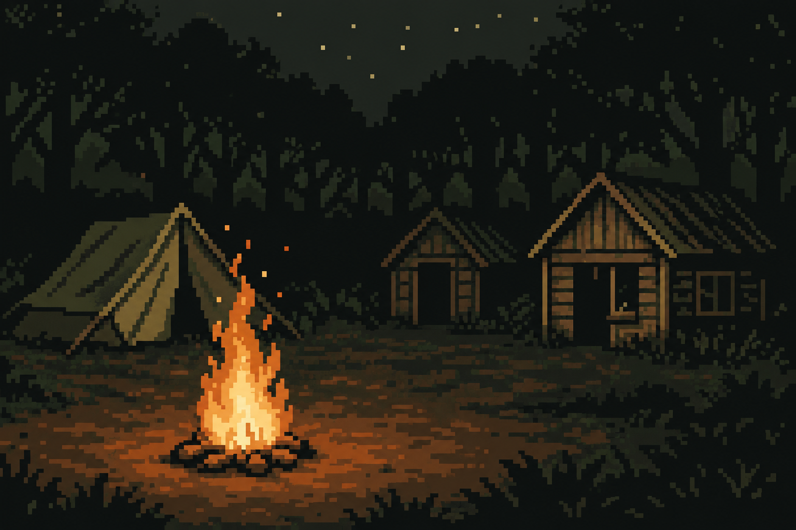

### Itens:

-Axe(Machado)       
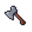     
Descrição:  
Item usado para cortar arvores.

-Batery(Bateria)     
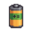      
Descrição:  
Item usado para recarregar a lanterna.

-Cereal Bar(Barra de Cereal)     
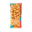       
Descrição:  
A Barra de Careal aumenta a Energy e a Sanidade do Player em 5 pontos.

-Energy Drink(Energetico)    
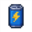     
Descrição:  
Aumanta a Energia do Player em 25 pontos.

-Flash(Lanterna)     
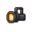     
Descrição:  
Ajuda a iluminar os locais escuros.

-Lighter(Esqueiro)   
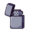     
Descrição:  
Item usado para acender a Fogueira.

-Map(Mapa)   
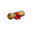     
Descrição:  
Ajuda a se localizar no Acampamento.

-Money(Dinheiro)     
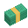       
Descrição:  
Pode ser usado como combustivel para a Fogueira ou comprar coisas na Maquina de Lanches.

-Remedy(Remedio)     
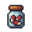      
Descrição:  
Aumenta a Sanidade do player em 25 pontos.

-Snack(Lanche/Salgadinho)    
       
Descrição:
Aumenta a Sanidade do Player em 10 pontos.

-Stick(Graveto)      
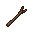       
Descrição:  
Serve como combustivel para a Fogueira aumentando um pouco sua durabilidade.

-Log(Tronco)     
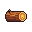     
Descrição:  
Serve como combustivel para a Fogueira aumentando ao maximo sua durabilidade.

## Beta 0.1  
-Tela de load criado  
-Nickname funcionando  
-Lanterna agora precisa de estar com ela na hotbar e precionar F para funcionar  
-Opções de dicas para ver teclas usaveis adicionado  
-Um breve mapa adicionado   
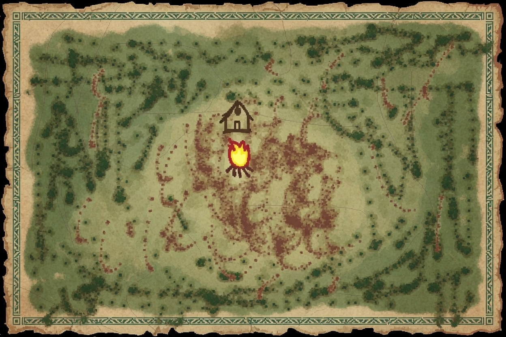

-Inventario na barraca para guardar itens adicionado, porem sem funcionalidade ainda  
-Fogueira agora é alimentada apenas chegando perto dela e precionando a tecla 1 ou 2 do teclado numerico superior  
-Chat adicionado durante a partida
## Beta 0.2
-Correções de bugs da versão anterior    
-Sistema de cheats simples adicionado    
-Agora é possivel enviar as mensagens precionando Enter    
-Itens adicionado:    
* Lanche(salgadinho),

* Barra de cereal,  

* Isqueiro  

    
-Maquina de lanches e refrigerante adicionado   
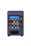

-Botão para sair do lobby adicionado    
-Agora o player só consegue correr com mais de 20 de energya e não consegue andar se estiver com 0 de energia    
-Tela de Morte adicionando    
-Agora o player morre se a sanidade chegar a 0    
-Animação para Bolsa adicionado    
-Agora as arvores não desaparecem depois de cortadas e voltam a crescer    
-Botões de configuração e escolha de personagens adicionados no lobby, porem, sem funcionalidades no momento    
-Foi adicionado descrição aos itens    
-Quantidade de sanidade e energia adicionados nas barras    
## Beta 0.3    
-Correções de Bugs    
-Seleção de personagem funcional    
-3 personagens adicionados, Jason, Samantha e Tina   

### Jason   
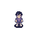

### Samantha
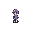

### Tina
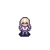

-Itens adicionados:
* Dinheiro

-Sprites e animações dos personagens adicionados    
-Modificações no menu inicial, como nova animação inicial
